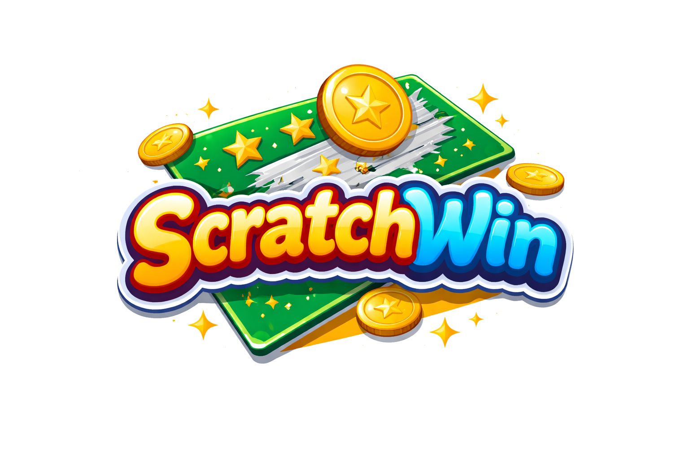

<p align="center">
  
</p>

# ScratchWin

ScratchWin est une petite webapp full-stack de tickets a gratter, pensee pour etre rapide a terminer, lisible a reprendre, et suffisamment propre pour servir de projet portfolio.

L'application permet a un utilisateur de s'inscrire, se connecter, consulter son solde, acheter un ticket, le gratter, voir le resultat immediatement, puis retrouver l'historique de ses parties.

## Sommaire

- [Presentation](#presentation)
- [Fonctionnalites](#fonctionnalites)
- [Les 5 tickets](#les-5-tickets)
- [Stack technique](#stack-technique)
- [Architecture du projet](#architecture-du-projet)
- [Structure des dossiers](#structure-des-dossiers)
- [Base de donnees](#base-de-donnees)
- [Variables d'environnement](#variables-denvironnement)
- [Installation et lancement](#installation-et-lancement)
- [Mode PWA](#mode-pwa)
- [Authentification](#authentification)
- [API REST principale](#api-rest-principale)
- [Points pedagogiques du projet](#points-pedagogiques-du-projet)
- [Pistes d'amelioration](#pistes-damelioration)

## Presentation

ScratchWin simule une experience de tickets a gratter dans une application web moderne:

- l'utilisateur cree un compte ou se connecte
- il dispose d'un solde de credits
- il choisit un ticket parmi 5 types differents
- le serveur calcule le resultat de la partie
- le frontend affiche un vrai effet de grattage
- le gain est ajoute automatiquement au solde si la partie est gagnante
- l'historique des parties reste disponible dans le dashboard

Le projet a ete pense avec une priorite claire: eviter l'overengineering tout en gardant une structure backend/frontend pedagogique.

## Fonctionnalites

### Cote utilisateur

- inscription
- connexion
- persistance de session avec refresh token
- consultation du profil et du solde
- liste des tickets disponibles
- achat d'un ticket
- grattage interactif avec effets visuels et sonores
- resultat immediat apres revelation
- historique des parties
- filtre simple sur l'historique

### Cote produit

- 5 tickets avec identite propre
- logique de gain calculee cote serveur
- seed SQL initial des tickets et des paliers de gain
- interface responsive desktop/mobile
- mode PWA installable
- mode clair / mode sombre

### Cote experience

- son de grattage
- son de gain
- son de jackpot
- son de perte
- petites particules pendant le grattage
- navigation mobile dediee

## Les 5 tickets

| Ticket | Prix | Style | Regle principale |
| --- | ---: | --- | --- |
| Flash | 2.00 | rapide, petits gains | trouver l'eclair gagnant |
| Fortune | 5.00 | gains moyens | trouver la couronne royale |
| Jackpot | 10.00 | ticket premium | trouver le symbole rare pour viser le gain max |
| Mystere | 4.00 | plus aleatoire | reveler deux cases mystere gagnantes |
| Lucky 7 | 3.00 | symboles | obtenir au moins deux symboles `7` |

Les tickets sont seedes dans [backend/src/db/scratchwin.sql](backend/src/db/scratchwin.sql).

## Stack technique

### Backend

- Node.js
- Express
- mysql2
- bcryptjs
- JSON Web Token
- express-validator

### Frontend

- Vue 3
- Vite
- Vue Router
- Pinia
- Fetch API

### Base de donnees

- MySQL 8

### PWA

- Web App Manifest
- Service Worker
- icones d'installation

## Architecture du projet

Le projet suit un decoupage volontairement simple.

### Backend

- `routes` pour definir les endpoints
- `controllers` pour recevoir la requete HTTP
- `services` pour la logique metier
- `models` pour centraliser les requetes SQL
- `middleware` pour l'auth, la validation et la gestion d'erreurs

### Frontend

- `views` pour les pages
- `components` pour les blocs UI reutilisables
- `stores` pour l'etat global avec Pinia
- `router` pour la navigation
- `api` pour les appels HTTP

## Structure des dossiers

```text
ScratchWin/
|-- backend/
|   |-- .env.example
|   |-- package.json
|   |-- public/
|   `-- src/
|       |-- app.js
|       |-- server.js
|       |-- config/
|       |   |-- database.js
|       |   `-- env.js
|       |-- controllers/
|       |   |-- authController.js
|       |   |-- gameController.js
|       |   `-- ticketController.js
|       |-- db/
|       |   `-- scratchwin.sql
|       |-- middleware/
|       |   |-- authMiddleware.js
|       |   |-- errorMiddleware.js
|       |   `-- validateRequest.js
|       |-- models/
|       |   |-- gameModel.js
|       |   |-- refreshTokenModel.js
|       |   |-- ticketModel.js
|       |   `-- userModel.js
|       |-- routes/
|       |   |-- authRoutes.js
|       |   |-- gameRoutes.js
|       |   `-- ticketRoutes.js
|       |-- services/
|       |   |-- authService.js
|       |   |-- gameEngineService.js
|       |   `-- gameService.js
|       `-- utils/
|           |-- apiError.js
|           |-- jwt.js
|           `-- pickWeightedReward.js
|-- frontend/
|   |-- .env.example
|   |-- .env.production
|   |-- index.html
|   |-- package.json
|   |-- vite.config.js
|   |-- public/
|   |   |-- apple-touch-icon.png
|   |   |-- favicon.png
|   |   |-- manifest.webmanifest
|   |   |-- sw.js
|   |   |-- audio/
|   |   |   `-- scratch.mp3
|   |   |-- branding/
|   |   |   `-- scratchwin-logo.png
|   |   |-- mobile-nav/
|   |   `-- pwa/
|   `-- src/
|       |-- App.vue
|       |-- main.js
|       |-- api/
|       |   `-- http.js
|       |-- assets/
|       |   `-- main.css
|       |-- components/
|       |   |-- AppHeader.vue
|       |   |-- HistoryList.vue
|       |   |-- MobileNav.vue
|       |   |-- RevealGrid.vue
|       |   |-- ScratchCell.vue
|       |   |-- SymbolToken.vue
|       |   `-- TicketCard.vue
|       |-- data/
|       |   `-- ticketRules.js
|       |-- router/
|       |   `-- index.js
|       |-- stores/
|       |   |-- auth.js
|       |   |-- games.js
|       |   |-- theme.js
|       |   `-- tickets.js
|       |-- utils/
|       |   `-- audio.js
|       `-- views/
|           |-- AuthView.vue
|           |-- DashboardView.vue
|           |-- HistoryView.vue
|           |-- HomeView.vue
|           |-- ScratchView.vue
|           `-- TicketsView.vue
`-- README.md
```

## Base de donnees

Le schema principal est dans [backend/src/db/scratchwin.sql](backend/src/db/scratchwin.sql).

### Tables principales

- `users`
  stocke les comptes utilisateur, l'email, le pseudo, le mot de passe hashe et le solde de credits

- `tickets`
  stocke les tickets disponibles, leur prix, leur probabilite de gain et leur type

- `ticket_rewards`
  stocke les differents paliers de gain pour chaque ticket avec un systeme de poids

- `games`
  stocke l'historique des parties jouees

- `refresh_tokens`
  stocke les refresh tokens hashs, leur date d'expiration et leur statut de revocation

### Important

Si tu avais deja importe une ancienne version du schema avant l'ajout des refresh tokens, reimporte le fichier SQL ou ajoute la table `refresh_tokens` depuis ce fichier avant de tester la connexion.

## Variables d'environnement

### Backend

Exemple de fichier `backend/.env`:

```env
PORT=4000
CLIENT_URL=http://localhost:4000
DB_HOST=127.0.0.1
DB_PORT=3308
DB_USER=root
DB_PASSWORD=root
DB_NAME=scratchwin
JWT_SECRET=change_this_secret
ACCESS_TOKEN_EXPIRES_IN=2h
REFRESH_TOKEN_EXPIRES_DAYS=30
```

### Frontend

Exemple de fichier `frontend/.env`:

```env
VITE_API_BASE_URL=http://localhost:4000/api
```

En production, le frontend utilise `frontend/.env.production` avec:

```env
VITE_API_BASE_URL=/api
```

## Installation et lancement

### 1. Prerequis

- Node.js 18+ recommande
- MySQL 8
- npm

### 2. Importer la base

Depuis la racine du projet:

```bash
mysql -u root -P 3308 -p < backend/src/db/scratchwin.sql
```

### 3. Installer et lancer le backend

```bash
cd backend
npm install
copy .env.example .env
npm run dev
```

Par defaut:

- backend sur `http://localhost:4000`
- API sur `http://localhost:4000/api`

### 4. Installer et lancer le frontend

Dans un autre terminal:

```bash
cd frontend
npm install
copy .env.example .env
npm run dev
```

Par defaut:

- frontend sur `http://localhost:5173`

### 5. Preparer le build Hostinger

Depuis `backend/`:

```bash
npm run build
```

Cette commande:

- build le frontend Vue
- copie `frontend/dist` dans `backend/public`
- prepare le backend pour servir aussi l'application Vue en production

Avec cette configuration:

- `GET /api/*` reste gere par Express
- toute autre route charge l'application Vue
- le refresh navigateur sur `/dashboard`, `/tickets` ou `/history` fonctionne

## Mode PWA

L'application peut etre installee comme une application mobile ou desktop.

### Ce qui est en place

- manifest web
- service worker
- icones PWA
- bouton d'installation sur la home
- disparition du bouton d'installation lorsque l'app est deja lancee en mode installe

### Fichiers PWA

- [frontend/public/manifest.webmanifest](frontend/public/manifest.webmanifest)
- [frontend/public/sw.js](frontend/public/sw.js)
- [frontend/public/pwa/icon-192.png](frontend/public/pwa/icon-192.png)
- [frontend/public/pwa/icon-512.png](frontend/public/pwa/icon-512.png)

## Authentification

L'auth repose sur deux couches:

- un access token JWT
- un refresh token persistant stocke en base

### Fonctionnement

- a la connexion ou a l'inscription, le backend renvoie un `token` et un `refreshToken`
- l'access token expire au bout de `2h`
- le refresh token permet de demander une nouvelle session sans reconnecter l'utilisateur
- le frontend rafraichit automatiquement la session toutes les 2 heures
- le frontend peut aussi tenter un refresh lors d'un retour de l'application au premier plan
- a la deconnexion, le refresh token courant est revoque

Ce comportement est utile pour une PWA, car l'utilisateur garde une session stable sans etre force de se reconnecter trop souvent.

## API REST principale

### Auth

- `POST /api/auth/register`
- `POST /api/auth/login`
- `POST /api/auth/refresh`
- `POST /api/auth/logout`
- `GET /api/auth/me`

### Tickets

- `GET /api/tickets`

### Parties

- `POST /api/games/play`
- `GET /api/games/history`

## Points pedagogiques du projet

Ce projet est utile pour apprendre ou montrer:

- une architecture Express simple mais propre
- la separation `route -> controller -> service -> model`
- la gestion d'une base MySQL avec `mysql2`
- la mise en place d'une auth JWT + refresh token
- l'integration Vue Router + Pinia
- la gestion d'une interface responsive
- la creation d'une petite PWA installable
- une logique metier centralisee cote serveur
- un deploiement full-stack simple sur un seul domaine via `backend/public`

## Pistes d'amelioration

- ajouter un vrai back-office admin
- ajouter des statistiques utilisateur plus poussees
- ajouter plusieurs niveaux de credits ou bonus journaliers
- rendre le service worker plus complet avec une vraie strategie de cache offline-first
- ajouter des tests automatises backend/frontend
- ajouter une page de regles plus detaillee

---

Projet realise avec une approche MVP: simple a comprendre, rapide a lancer, mais assez complet pour montrer une vraie coherence full-stack.
